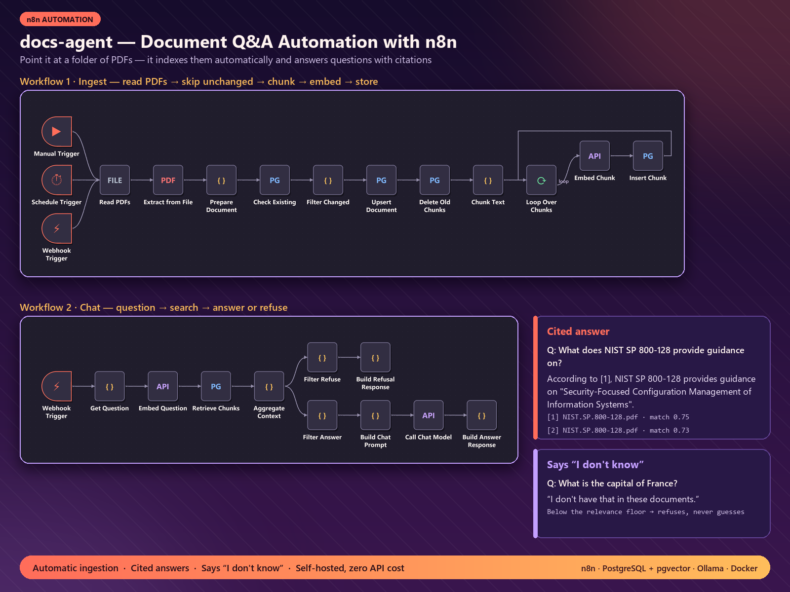
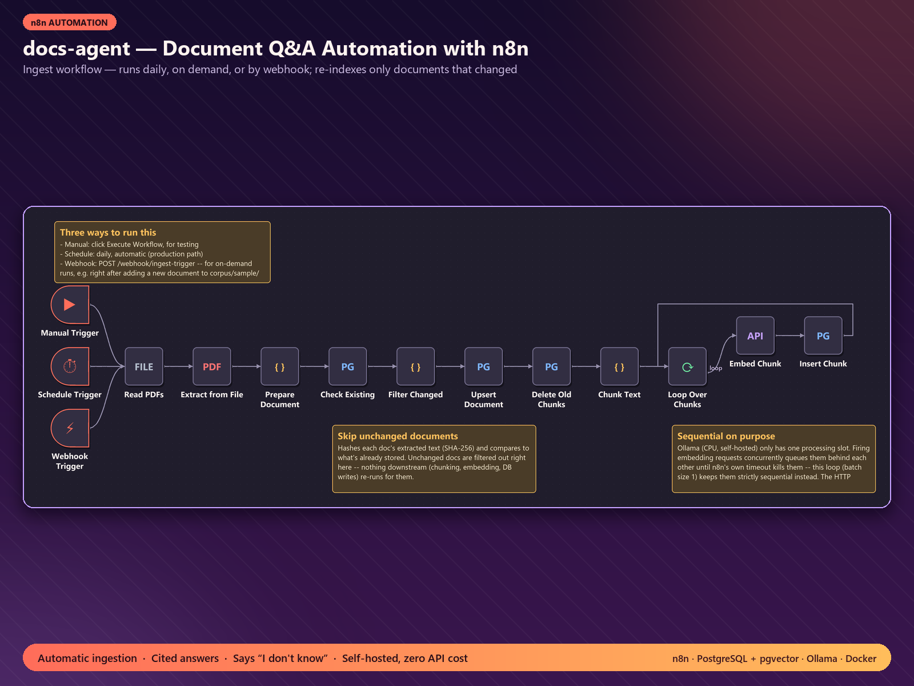
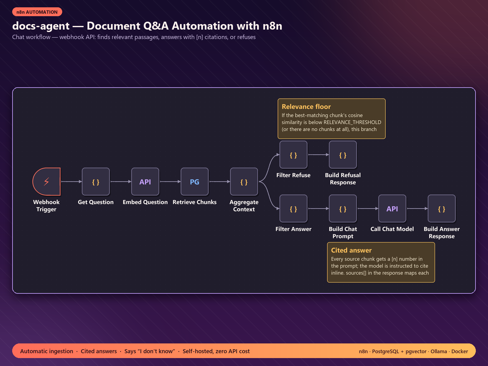

# docs-agent — document Q&A automation with n8n



Point it at a folder of PDFs. It indexes them on a schedule and answers questions through a webhook API,
**citing the exact source file for every claim** — and saying *"I don't have that in these documents"*
instead of guessing when the documents don't cover the question.

Everything runs on your own machine or server with Docker: **no external AI API, no per-question fees,
and documents never leave the host.**

## How it works

| Workflow | What it does |
|---|---|
| **01 · Ingest** (`workflows/01-ingest.json`) | Runs daily, on demand, or via `POST /webhook/ingest-trigger`. Reads PDFs, extracts text, hashes each document (SHA-256) and **skips unchanged files**, chunks the text, embeds each chunk, and stores it in PostgreSQL + pgvector. |
| **02 · Chat** (`workflows/02-chat.json`) | `POST /webhook/chat {"question": "..."}` → embeds the question, retrieves the closest chunks, and either refuses (best match below the relevance floor) or asks the chat model for an answer with `[n]` citations mapped back to the source files. |




## Stack
- **n8n** (self-hosted) for the workflows, exported as JSON and versioned in git
- **PostgreSQL 16 + pgvector** for documents, chunks and vector search (HNSW, cosine)
- **Ollama** for local embeddings (`nomic-embed-text`) and the chat model (`llama3.2`) — swappable via `.env`
- **Docker Compose** to run it all; a `Makefile` for the common commands

## Run it
```bash
cp .env.example .env        # fill in passwords / ports
make up                     # postgres + n8n + ollama
make import                 # load the two workflows into n8n
make ingest                 # index corpus/sample/
curl -X POST http://localhost:5678/webhook/chat -H "Content-Type: application/json" \
     -d '{"question": "What does NIST SP 800-128 provide guidance on?"}'
```
Example answer (real response from the system):
> According to [1], NIST SP 800-128 provides guidance on "Security-Focused Configuration Management of Information Systems".
> `sources: [1] NIST.SP.800-128.pdf (similarity 0.75), [2] NIST.SP.800-128.pdf (0.73)`

## Evaluation
`make eval` runs a golden set of 28 questions (20 answerable across all 15 sample documents, 8 that must be
refused) and writes a scored report — retrieval hit rate, faithfulness and refusal accuracy — to `eval/results/`.

## Project docs
[CLAUDE.md](CLAUDE.md) — architecture and working agreement · [PLAN.md](PLAN.md) — milestones and verification notes.

Sample corpus: public NIST publications (US government works).
